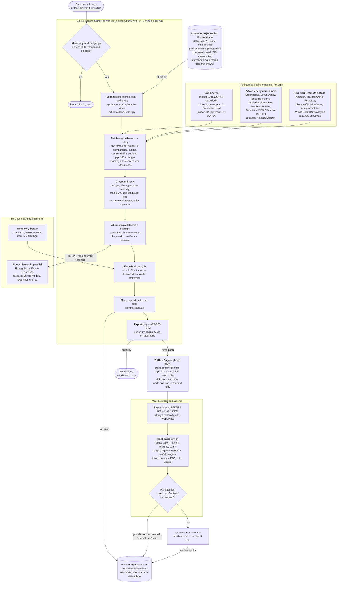

# job-radar

Free, fully GitHub-hosted job search automation for DevOps / SRE / platform roles. Every 4 hours it
searches India first, then remote, then the rest of the world, filters to roles you can actually get
(stated minimum 3 years or less), scores each against your resume with free AI, and publishes an
encrypted, password-protected dashboard. You apply by hand; nothing logs in anywhere or applies for you.

- **Dashboard**: `https://<your-github-username>.github.io/job-radar-dashboard/` (GitHub Pages, free)
- **Cost**: zero. Scans are paced through the month and hard-stop at 1,050 Actions minutes (CI adds ~50), so the
  total stays around 1,100 of the free 2,000/month at the very worst. Dashboard clicks cost 0 minutes.
- **Branch**: `prod` everywhere (this repo and the dashboard repo).

## What it does

| Area | Details |
|---|---|
| Sources | Indeed, Naukri, LinkedIn (public guest pages only, never your account); 400+ company career sites (Greenhouse, Lever, Ashby, SmartRecruiters, Workday) incl. Y Combinator companies, that grow automatically; Amazon/AWS and Microsoft job APIs; remote boards (Remotive, RemoteOK, We Work Remotely, Himalayas, Jobicy, HN Who is Hiring); Arbeitnow (visa-sponsored, Europe); worldwide rotation over 71 Indeed country sites + LinkedIn |
| Filters | target titles (~45 patterns), senior/lead/manager/level-3+ excluded, experience ≤ 3 years, ≤ 30 days old, expired postings removed, local-language-only jobs abroad removed, training "academies" removed |
| Ranking | **Apply next**: resume fit × location (Bangalore > Pune/Hyderabad > India > remote > abroad with visa) × experience fit × freshness × company, with reasons; closing-soon boost |
| AI apply kit | fit score, level fit, matched/missing skills, interview topics, red flags |
| Tailored resume | per job, printed to PDF in your own layout (one A4 page, Lato): bullets and skills reordered for the job, JD keywords added only when your resume already proves them, ATS keyword match before/after |
| Referral message | your 5-line format with the role and the employer's job ID filled in, plus a short note that fits LinkedIn's 300 characters; you send it yourself |
| Gmail sync | read-only: replies (rejection, assessment, interview, offer) move jobs you already marked applied; unclear emails are listed for you, never guessed |
| Autofill | Tampermonkey script for Greenhouse/Lever/Ashby forms: fills your details on click, optional AI draft for "Why us?"; never submits, never runs on LinkedIn |
| Learn | recent videos from 26 DevOps/cloud/AI channels, ranked by your stack and skill gaps |
| Lifecycle | closed-job checker (daily), ghost/repost warning, follow-up reminders after 7 days, daily goal + streak |
| Analytics | new jobs per day by region, your applications vs goal, skill gaps, strengths, hiring momentum, funnel, sources |
| Alerts | an email from GitHub when good new jobs arrive, plus a morning summary at ~8:47 AM IST |

## Architecture

A serverless system: GitHub Actions is the only compute (a fresh VM for ~5 minutes per run), the private repo is
the database, GitHub Pages is a global CDN for the static dashboard, and your browser decrypts the data locally.
No server, no database, $0. The full design, libraries, endpoints and cost model are in
[docs/ARCHITECTURE.md](docs/ARCHITECTURE.md).



## One-time setup (about 15 minutes)

You need: the free Groq and Gemini keys (already in your local `.env`), and two new GitHub items.

### 1. Create the public dashboard repo
github.com → **+** (top right) → **New repository** → name `job-radar-dashboard` → **Public** → leave
"Add a README" unchecked → **Create repository**. Leave it empty; the workflow fills it.

### 2. Create the publish token (lets this repo push to the dashboard repo only)
github.com → your photo → **Settings** → **Developer settings** → **Personal access tokens** →
**Fine-grained tokens** → **Generate new token**:
- Name `job-radar-publish`, Expiration: 1 year (set a calendar reminder to renew)
- Repository access: **Only select repositories** → `job-radar-dashboard`
- Permissions → Repository permissions → **Contents: Read and write** (nothing else)
- **Generate token**, copy it (starts with `github_pat_`).

### 3. Pick a dashboard passphrase
5 or more random words, e.g. `copper lantern mango orbit velvet` (make your own). The encrypted file is
public forever, so this passphrase is the only thing protecting it. Store it in your password manager.

### 4. Add 5 secrets to this repo
github.com/Karthik-099/job-radar → **Settings** → **Secrets and variables** → **Actions** →
**New repository secret**, once for each:

| Name | Value |
|---|---|
| `GROQ_API_KEY` | from your `.env` |
| `GEMINI_API_KEY` | from your `.env` |
| `OPENROUTER_API_KEY` | from your `.env` (credit limit 0, free models only) |
| `DASHBOARD_PASSWORD` | the passphrase from step 3 |
| `DASHBOARD_REPO_TOKEN` | the token from step 2 |

### 5. First run
**Actions** tab → if asked, click **I understand my workflows, go ahead and enable them** → **scan** →
**Run workflow** → branch `prod` → tick **backfill** → **Run workflow**. Takes about 5 minutes.

### 6. Turn on GitHub Pages
job-radar-dashboard → **Settings** → **Pages** → Source **Deploy from a branch** → Branch **prod** /
**(root)** → **Save**. About a minute later the dashboard is live at
`https://karthik-099.github.io/job-radar-dashboard/`.

### 7. Email alerts
github.com → your photo → **Settings** → **Notifications**: set the default email to your Gmail and make
sure **Watching → Email** is ticked. On the job-radar repo page, **Watch** should show "All Activity".

### 8. Optional: sync your marks to every device
Uses the token you already made (`job-radar-status`). Paste it in the dashboard → **Settings** → Sync →
**Save** → **Test**. Without a token, marks are saved in that browser only (still fully usable).

The dashboard picks the cheapest way the token allows:
- **Free (recommended, 1 minute once):** give the same token one more permission. github.com → your photo →
  **Settings** → **Developer settings** → **Personal access tokens** → **Fine-grained tokens** → click
  `job-radar-status` → **Edit** → **Repository permissions** → **Contents** → **Read and write** → **Update**.
  Then press **Test** in the dashboard. Marks are saved as small files (0 Actions minutes) and other devices see them
  after Refresh.
- **Without that permission:** it still works through a short workflow run (~1-2 Actions minutes), batched to at most
  one run every 5 minutes. Counted in the 1,050-minute cap.

Extra isolation (optional, advanced): set repo variable `INBOX_REPO` + secret `INBOX_TOKEN` to keep the inbox in a
separate private repo, so the browser token can never write code. Not needed for normal use.

### 9. Optional: Gmail status sync (read-only, about 10 minutes, once)
Jobs you marked **Applied** move to Rejected / Shortlisted / Interview / Offer when the company replies.
The token can only *read*: Google refuses delete, move, label or send for it.

1. console.cloud.google.com → top bar project picker → **New project** → name `job-radar` → **Create**, then select it.
2. Search bar: **Gmail API** → **Enable**.
3. Left menu **APIs & Services** → **OAuth consent screen** (or **Google Auth Platform**) → **Get started**:
   app name `job-radar`, your Gmail as support email → Audience **External** → your Gmail as contact → **Create**.
4. **Audience** → **Test users** → **Add users** → your Gmail → **Save**. Then on the same page click
   **Publish app** → **Confirm** (otherwise Google expires the token every 7 days; you are the only user, and
   the "unverified app" warning you'll see on sign-in is expected for a personal app).
5. **Data access** → **Add or remove scopes** → tick `.../auth/gmail.readonly` only → **Update** → **Save**.
6. **Clients** → **Create client** → type **Desktop app** → name `job-radar` → **Create** → copy the Client ID
   and Client secret into your local `.env` as `GMAIL_CLIENT_ID=` and `GMAIL_CLIENT_SECRET=`.
7. Terminal, in this folder: `.venv/bin/python -m src.gmail_auth` → browser opens → pick your Gmail →
   "Google hasn't verified this app" → **Continue** → tick read access → **Continue**. It saves
   `GMAIL_REFRESH_TOKEN` into `.env` (nothing is printed).
8. Check before trusting it: `.venv/bin/python -m src.gmail_sync --dry-run` lists what it *would* change.
   If Google refuses sign-in after step 4 ("access blocked"), set the app back to **Testing**: it works the same,
   but the token expires every 7 days (the scan then skips Gmail and logs it; rerun step 7 and update the secret).
9. Add 3 repo secrets (Settings → Secrets and variables → Actions → New repository secret), copying each value
   from `.env`: `GMAIL_CLIENT_ID`, `GMAIL_CLIENT_SECRET`, `GMAIL_REFRESH_TOKEN`. The next scan uses them.

### 10. Optional: autofill for Greenhouse, Lever and Ashby
Install the Tampermonkey extension → dashboard **Settings** → **Install autofill script** → **Install**.
Tampermonkey icon → **Job Radar: my details** → fill your details once (stored only in your browser).
On an application page click **⚡ Fill my details**, check everything, attach the tailored PDF, submit yourself.

### 11. Optional: more videos in Learn
A free YouTube Data API key (console.cloud.google.com → APIs & Services → Library → **YouTube Data API v3** →
Enable → Credentials → **Create credentials → API key**, restrict it to that API) adds each section's most-watched
videos of the month from all of YouTube. Save it as repo secret `YOUTUBE_API_KEY`. Uses ~2,000 of 10,000 free daily units.

## Daily use

1. Open the email or the dashboard, enter your passphrase.
2. **Today** shows Apply next, fresh jobs from the last 24 hours, closing-soon, and follow-ups.
3. **Open job** → apply on the company site → **Mark applied**. It moves to the Applied column.
4. Open **Details**: **Download tailored resume (PDF)** (print window → Save as PDF, A4, headers/footers off),
   the referral message (replace `[Name]`, copy), interview topics, and **Find a referrer** (opens a normal
   LinkedIn people search in your browser; nothing on LinkedIn is automated).
5. Jobs you applied to, and the same role found again under another city or board, disappear from the lists.
6. **Learn** has fresh videos by topic (System Design, DevOps, DevSecOps, Architecture, AWS, Azure, Kubernetes,
   Observability & SRE, AI & MLOps, Career). **Map** is a satellite globe (NASA imagery; "Map style" for a plain one): click any country for its
   matching jobs and top tech employers. **Insights** shows your funnel, reply rates by source, and whether high fit scores get replies.
7. Keyboard: `Ctrl K` search everything, `g j` jobs, `j`/`k` move, `a` applied, `x` hide, `?` all shortcuts.
   Themes: the moon button (Light, Dark, Midnight, Aurora, or match the system).

## Local commands

```bash
.venv/bin/pip install -r requirements-dev.txt
git config core.hooksPath .githooks                     # once: blocks committing secrets
.venv/bin/python -m pytest && node tests/js/crypto.test.mjs
.venv/bin/python -m src.main --dry-run                  # everything except saving/publishing/emailing
.venv/bin/python -m src.main --source workday --dry-run # one source
.venv/bin/python -m src.main --dry-run --countries japan,canada
.venv/bin/python -m src.discover "Company A" "Company B" # add companies' career sites
```

| Flag | Meaning |
|---|---|
| `--dry-run` | fetch, filter, score, print; write nothing |
| `--source NAME` | only these sources (repeatable or `a,b`) |
| `--backfill` | look back 30 days instead of each source's window |
| `--countries a,b` | world sources scan these countries instead of the rotation |
| `--max-llm N` | AI-score at most N jobs this run (cache hits are free) |
| `--no-score` / `--no-fetch` | skip AI scoring / work from saved state only |
| `--export` / `--notify` | build the encrypted dashboard / post the email digest (CI) |
| `--check-closed` | run the closed-job check now |
| `--gmail` | update applied jobs from Gmail replies (read-only) |

## Tuning

Everything lives in [profile/preferences.yaml](profile/preferences.yaml): title patterns, exclusions,
experience cap, city boosts, abroad countries, language rule, sources and their search terms, daily goal.
Your resume for scoring is [profile/resume.md](profile/resume.md) (no contact details, sent to the AI). The PDF is
printed from [profile/resume.yaml](profile/resume.yaml) (never sent to any AI): edit both when your resume changes.
Learn channels: [profile/youtube_channels.yaml](profile/youtube_channels.yaml).

## Docs

- [docs/SECURITY.md](docs/SECURITY.md): what is and isn't protected, and what to do if a key leaks
- [docs/TROUBLESHOOTING.md](docs/TROUBLESHOOTING.md): common problems and fixes
