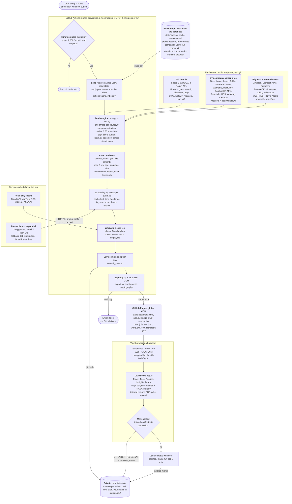

# Job Radar architecture

Job Radar finds DevOps / SRE / platform jobs across the internet every few hours, scores them against your resume
with free AI, and shows them in a private dashboard. It has **no server, no database and no monthly bill**.

- [1. Architecture style: serverless batch + static site](#1-architecture-style-serverless-batch--static-site)
- [2. The big picture](#2-the-big-picture)
- [3. How it "scans the internet"](#3-how-it-scans-the-internet)
- [4. The fetch engine](#4-the-fetch-engine)
- [5. The processing pipeline](#5-the-processing-pipeline)
- [6. The AI layer](#6-the-ai-layer)
- [7. Storage: Git as the database](#7-storage-git-as-the-database)
- [8. The dashboard: no backend](#8-the-dashboard-no-backend)
- [9. Cost model](#9-cost-model)
- [10. Code map](#10-code-map)

---

## 1. Architecture style: serverless batch + static site

Job Radar is a **serverless, event-driven batch system with a static front end**. Its parts:

| Classic system piece | What Job Radar uses instead | Why |
|---|---|---|
| Always-on backend server | **GitHub Actions** runners, started by a schedule, live ~5 minutes, then destroyed | Pay-per-use compute that is free within GitHub's quota; nothing to patch or keep alive |
| Database | **The private Git repo** (`state/`, `profile/`, `companies.yaml`) | Versioned, backed up, diffable, free; every change has history |
| Web server / API | **GitHub Pages** (served from a global CDN) with static files only | Fast everywhere, free, nothing to attack server-side |
| Login + access control | **Client-side encryption**: data is AES-256-GCM ciphertext; your browser decrypts it with your passphrase | The host never sees your data, so a public host is safe ("zero-knowledge" hosting) |
| Message queue for user actions | **Small JSON files** the browser commits to `state/inbox/` through GitHub's API | Durable, ordered, 0 Actions minutes; the next run consumes them |
| Paid AI API | **Free tiers** of several AI providers in parallel, with caching and a keyword fallback | $0, and never blocked by one provider's limits |

This combination is often called **JAMstack** (static JavaScript + APIs + markup) with **GitOps state**: the
repository is the single source of truth, and scheduled jobs reconcile it with the outside world.

---

## 2. The big picture

What happens on a schedule tick, in one sentence: a fresh Linux machine boots, checks the minutes budget, pulls jobs
from ~800 sources in parallel for at most 3 minutes, filters and ranks them, asks free AI models to score the best
ones, writes the results back to the private repo, encrypts a dashboard file, publishes it to the CDN, and shuts down.

---

## 3. How it "scans the internet"

It does **not crawl the whole web**. Crawling is slow, unreliable and often against site rules. Instead it pulls
from the places jobs are actually published, almost always through **structured endpoints** (JSON APIs, RSS feeds),
which are fast, stable and meant to be read by programs.

| Source family | How it is read | Library | Module |
|---|---|---|---|
| Indeed (India + 71 country sites) | Indeed's mobile GraphQL search API | `python-jobspy` (uses `requests`, `pandas`) | `src/sources/jobspy_source.py` |
| LinkedIn | The public, logged-out job search pages (no account, nothing automated on your profile) | `python-jobspy` + `beautifulsoup4` | same |
| Naukri | Naukri's job search API | `python-jobspy` | same |
| Glassdoor, Bayt | Search pages, fetched with a browser-like TLS fingerprint | `python-jobspy` + `curl_cffi` | same |
| Greenhouse, Lever, Ashby, SmartRecruiters | Each ATS's documented public job-board JSON API | `requests`, `beautifulsoup4` (HTML descriptions to text) | `src/sources/ats.py` |
| Workday | The CXS JSON API every Workday careers site uses (POST a search, GET each job) | `requests` | `src/sources/ats.py` |
| Workable, Recruitee, BambooHR | Public JSON job APIs | `requests` | `src/sources/ats.py` |
| Teamtailor | Public RSS feed | `requests` + `xml.etree` | `src/sources/ats.py` |
| Amazon, Microsoft | Their public career search APIs | `requests` | `src/sources/bigtech.py` |
| Remote boards, HN | Public JSON APIs / RSS | `requests`, `xml.etree` | `src/sources/boards.py` |

**Why company career sites matter most:** a job appears there first, with the full description, and the posting id
the company's referral portal understands. Board listings are used to *discover* new companies: when Indeed links to
`boards.greenhouse.io/<company>`, `src/learn.py` adds that company, and from the next run it is polled directly.
`src/discover.py` finds career sites for company names in bulk (it probes the ATS APIs by name).

---

## 4. The fetch engine

Fetching ~800 sources one by one would take an hour. The engine runs them concurrently, isolates failures, and
stops on a time budget so a run always finishes in a few minutes.

- **Isolation:** every source runs in its own thread inside a `try/except`; one broken site never stops the rest.
  The run summary lists each source's count, time and error.
- **Politeness:** a per-host gap of 0.35 s, `Retry-After` honoured, an identifying User-Agent, and only public pages.
- **Early filtering:** sources skip titles that can't match and URLs already known (`FetchContext.wants()`,
  `is_known()`), so detail pages are fetched only for new, relevant jobs.
- **Budget:** each source checks `ctx.time_left()`; anything still running at the deadline is abandoned.

---

## 5. The processing pipeline

| Stage | What it does | Module | Libraries |
|---|---|---|---|
| Enrich | Classifies India / remote / abroad, reads "3+ years", visa and deadline wording | `src/filters.py`, `src/geo.py` | `re`, `python-dateutil` |
| Dedupe | Hash of normalised company + title + city; URL normalisation drops tracking params | `src/dedupe.py`, `src/models.py` | `hashlib`, `urllib.parse` |
| Filter | Your rules from `profile/preferences.yaml` | `src/filters.py`, `src/config.py` | `PyYAML`, `re` |
| Same-role / ghost jobs | Fingerprints roles across cities and boards; flags roles re-posted 3+ times in 60 days | `src/tracking.py` | |
| Keywords | ~120 DevOps/cloud keywords with "proof" patterns, used for ATS match and tailoring | `src/tailor.py` | `re` |
| Rank | `35 fit + 20 location + 15 level + 20 freshness + 10 company`, minus penalties | `src/recommend.py` | |
| Lifecycle | Daily re-check of saved links (ATS APIs or page text) to flag closed postings | `src/tracking.py` | `requests` |
| Gmail | Reads hiring replies, moves jobs you applied to (read-only scope) | `src/gmail_sync.py` | `requests`, `email` |
| Learn / Map data | YouTube channel RSS (twice a day); Wikidata SPARQL for employers by country (monthly) | `src/videos.py`, `src/world.py` | `xml.etree`, `requests` |

---

## 6. The AI layer

Every AI call is free. Several providers run as parallel "lanes" pulling from one work queue, so a rate limit on one
just shifts work to the others.

- **Prompt-prefix caching:** the fixed instructions and your resume are sent first, byte-identical every call, so
  providers can reuse that part (cheaper, faster, and on Groq it doesn't count against rate limits).
- **Batching:** 4 jobs per call.
- **Result cache:** `state/score_cache.json`, 60 days. Re-posts and re-runs cost nothing.
- **Other AI tasks use the same lanes:** cover letters (fact-checked, `src/letters.py`), Gmail reply checks, and
  structuring an uploaded resume (`src/resume_import.py`, every bullet must appear word for word in your PDF).

---

## 7. Storage: Git as the database

| Path | Contents | Written by |
|---|---|---|
| `state/jobs.json` | Every tracked job, one JSON object per line (small diffs) | Each scan; atomic write |
| `state/score_cache.json` | AI results by content hash | Scoring |
| `state/usage.json` | Billed Actions minutes per month | Every run |
| `state/inbox/*.json` | Your marks, notes, resume uploads from the browser | The dashboard (GitHub API); deleted once applied |
| `state/world.json` | Employers by country | Monthly |
| `profile/` | Resume (scoring text + structured PDF data), preferences, channels | You (or a resume upload) |
| `companies.yaml` | 775 career sites | Discovery and auto-learning |

Concurrency: scans and dashboard writes never edit the same file (scans own `state/jobs.json`, the browser only
creates new inbox files), and the scan commit retries with `git pull --rebase` if the repo moved meanwhile.

---

## 8. The dashboard: no backend

| Part | Technology |
|---|---|
| App | Plain JavaScript, no framework, no build step (`dashboard/app.js`) |
| Decryption | Browser WebCrypto: PBKDF2-SHA256 (600,000 rounds) + AES-256-GCM; data is gzipped before encryption |
| Globe | `d3-geo` orthographic projection + a WebGL shader painting NASA Blue Marble imagery; borders from Natural Earth via `topojson-client` (`dashboard/map.js`) |
| Resume PDF | Rendered in the page (Lato font, A4) and saved with the browser's "Save as PDF" |
| Resume upload | `pdf.js` reads the PDF's text inside your browser |
| Offline | A service worker keeps the last copy |
| Security | Strict Content-Security-Policy (only its own files, no CDN scripts), all job text inserted as text never HTML, versioned asset URLs |

All libraries are pinned copies in `dashboard/vendor/` (licenses in its README), served from the same origin.

---

## 9. Cost model

| Resource | Free allowance | Job Radar's use |
|---|---|---|
| GitHub Actions (private repo) | 2,000 min / month | Hard cap 1,050 for scans + ~50 CI. A scan bills ~5-6 min; skipped runs 1 min; dashboard clicks 0 |
| GitHub Pages | Free, CDN-served | ~2-3 MB of static files |
| Git storage | Free | `state/` grows a few KB per run |
| Groq / Gemini / GitHub Models / OpenRouter :free | Free tiers, rate-limited | ~80 calls a day, mostly cache hits; keyword fallback if all are busy |
| Gmail API, YouTube RSS, Wikidata | Free | Read-only, small volumes |
| **Total** | | **$0** |

How the minutes cap works (`src/budget.py`): before installing anything, the run compares this month's recorded
minutes with `1,050 x (fraction of month elapsed) + 60`. If it is ahead of that line, or at the cap, it records one
minute and stops. So early-month bursts can't starve the end of the month, and the total can't pass ~1,100.

---

## 10. Code map

| Workflow | Trigger | Does |
|---|---|---|
| `.github/workflows/scan.yml` | Every 4 h + manual | The whole pipeline above |
| `.github/workflows/update-status.yml` | Dashboard, only if your token lacks Contents permission | Applies marks and republishes |
| `.github/workflows/ci.yml` | Code pushes | Tests (Python + JavaScript) and secret scan |

Python dependencies (pinned in `requirements.txt`): `python-jobspy`, `requests`, `beautifulsoup4`, `PyYAML`,
`python-dateutil`, `cryptography`. Everything else is the Python standard library.
